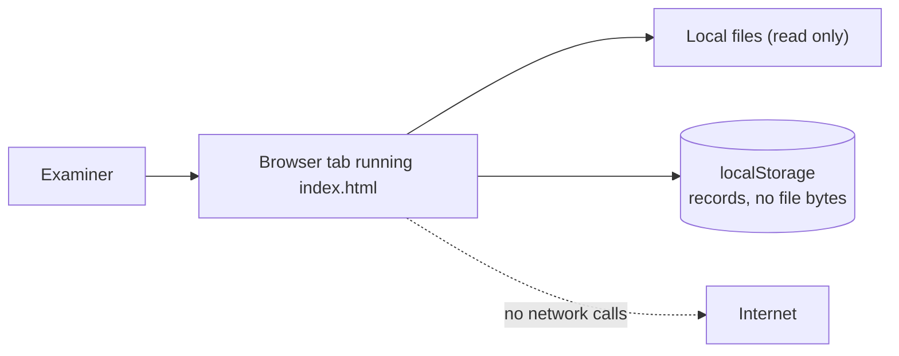
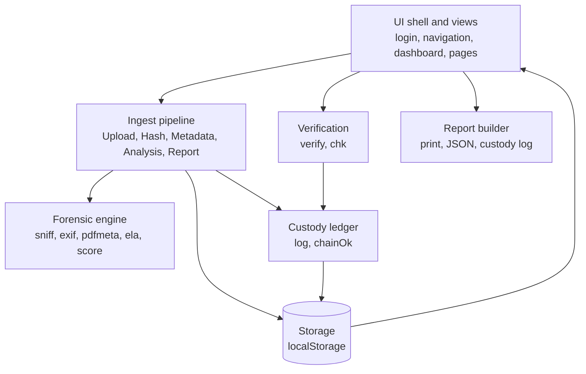
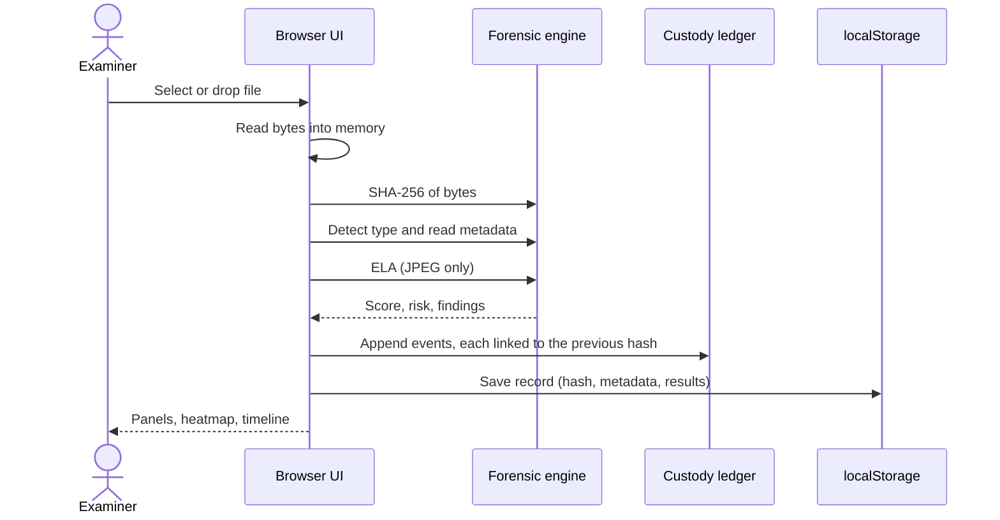
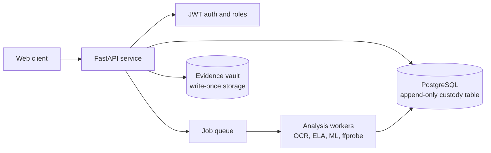

Architecture
1. Context
EvidenceLens runs entirely inside the examiner's browser. There is no backend. The only persistent store is the browser's `localStorage`, and the only inputs are files the examiner selects.

2. Component view
The application is one file with clearly marked sections.

Component	Responsibility	Section marker in `index.html`
Forensic engine	Pure analysis functions. No DOM access, easy to test in isolation	`forensic engine`
Custody ledger	Appends hash-linked events and verifies the chain	`chain of custody (hash-linked)`
Ingest pipeline	Orchestrates the five stages for each file and reports progress	`pipeline`
UI helpers	Gauges, bars, heatmap, tables, timeline renderers	`ui helpers`
Views	One function per page	`views`
Panels and analytics	Tamper detection, authenticity, pie, line, radar, health	`video-style panels`
Shell	Login, navigation, theme, refresh, render loop	`shell`
3. Data flow: evidence intake

4. Data flow: verification
Examiner selects a file and optionally a target record.
SHA-256 of the file is computed.
If a target is chosen it is compared against that record. Otherwise the registry is searched for the hash.
The outcome is appended to the record's custody chain. A mismatch also increments the record's failure counter, which sets its status to tampered.
5. Data model
Each evidence record is a JSON object:
```json
{
  "id": "EVD-2026-1001",
  "name": "photo.jpg",
  "size": 183204,
  "kind": "jpeg",
  "cat": "image",
  "hash": "<64 hex characters, SHA-256>",
  "ts": "2026-10-30T10:15:00.000Z",
  "by": "examiner",
  "exif": { "Make": "...", "Software": "...", "DateTime": "...", "GPS": 1 },
  "ela": { "g": [ "64 cell values" ], "cv": 0.412 },
  "mismatch": false,
  "score": 88,
  "risk": "Low",
  "find": [ "plain-language findings" ],
  "fails": 0,
  "chain": [
    { "t": "ISO time", "a": "action", "by": "actor", "d": "detail", "p": "previous hash", "h": "this entry's hash" }
  ]
}
```
Storage keys: `evl` (all records, sequence counter, last measured timings) in `localStorage`; `evu` (demo session) in `sessionStorage`.
6. Custody ledger design
Each entry stores `h = SHA-256(p + t + a + by + d)`, where `p` is the previous entry's hash. The first entry uses 64 zeros as `p`. The check recomputes every hash in order and fails if any entry or link differs.
What this gives you: detection of an edited, inserted or removed entry in the middle of a chain.
What it does not give you: protection against someone who rewrites the entire chain consistently, because all inputs are available locally. Real protection needs an external anchor, such as a server-side append-only table, digital signatures, or a trusted timestamp. This is on the roadmap.
7. Security model
Threat	Current behaviour	Residual risk	Planned mitigation
Spoofed identity	Demo sign-in, no real authentication	Anyone can act as any user	Server-side auth with JWT and roles
Stored record edited	Partial edits break the chain check	Full chain rewrite is possible	Signed or server-anchored ledger
Deleted evidence	Delete and Clear all data exist for testing	Audit trail is lost with the record	Soft-delete with a permanent audit table
Untrusted time	Device clock	Backdating is trivial	Trusted timestamping
Data disclosure	Files never leave the browser	Browser profile access exposes records	OS-level protection, optional encryption at rest
Malicious file content	Only reads bytes. Does not execute or render PDFs	Parser bugs on crafted files	Fuzz testing, size limits
Cross-site scripting via names or metadata	All user-derived text is escaped before rendering	Regression risk	Automated test, CSP meta tag
Very large files	Read fully into memory	Slowdown or tab crash	Streaming hash, size limit
8. Deployment
A static file served over HTTPS. GitHub Pages is the reference deployment. Local use works through `python -m http.server` or by opening the file directly.
Browser APIs relied on: Web Crypto (`crypto.subtle`), Canvas 2D, Blob and object URLs, `localStorage`, `sessionStorage`. Web Crypto requires a secure context (HTTPS or `localhost`).
9. Architecture decisions
ID	Decision	Reason	Trade-off
AD1	Client-side, single static file	Zero setup, privacy by default, easy to review	No shared state, no real access control
AD2	SHA-256	Standard (FIPS 180-4), available natively in browsers	No stronger guarantee than the algorithm gives
AD3	Hash-linked custody log	Simple tamper evidence without a server	Does not stop a full rewrite
AD4	`localStorage` for records	Persistence with no backend	Limited capacity, per-browser
AD5	Transparent additive scoring	Explainable and easy to audit	Weights are heuristic, not statistically calibrated
AD6	No dependencies	Nothing to audit or update	Hand-written parsers need careful testing
10. Target architecture (roadmap)

Planned API surface: `POST /evidence`, `GET /evidence`, `GET /evidence/{id}`, `POST /evidence/{id}/verify`, `GET /evidence/{id}/custody`, `GET /evidence/{id}/report`, `POST /news/check`.
