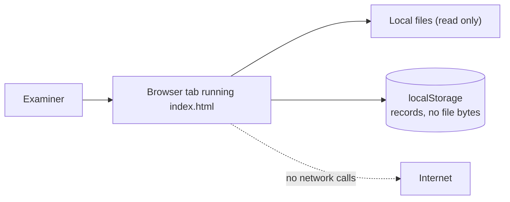
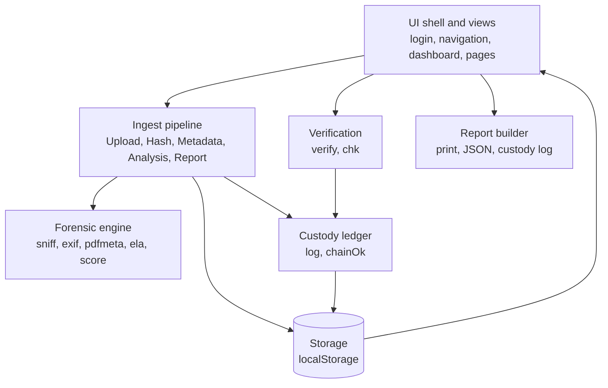
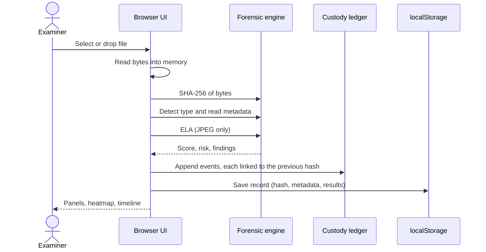
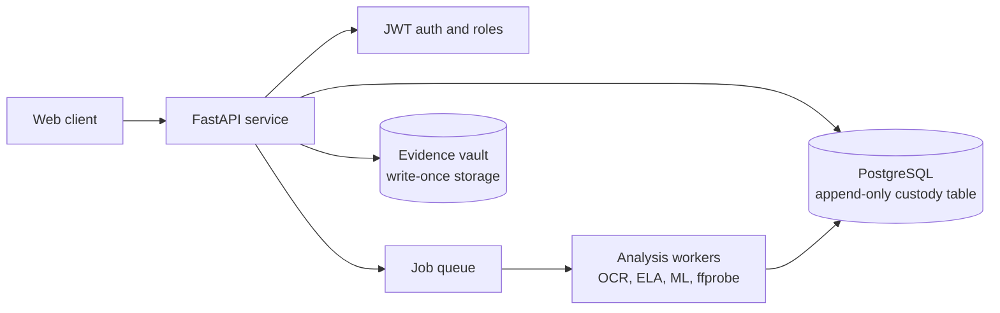

# EvidenceLens Architecture

**EvidenceLens runs entirely inside the examiner's browser.** There is no backend ecosystem, no remote database, and no network data transmission path. The system operates locally by leveraging native browser APIs, client-side cryptographic hashing, and `localStorage` persistence.

---

## 1. Context

The application is completely self-contained within the browser sandbox, providing strict data privacy by design. Raw evidence files never leave the examiner's machine.


---



---

## 2. Component View

The implementation is structured inside a single, highly cohesive file with clearly partitioned functional blocks marked directly in `index.html`.



| Component | Responsibility | Section Marker in `index.html` |
| :--- | :--- | :--- |
| **Forensic engine** | Pure analysis functions. Dom-free execution for seamless isolated unit testing. | `forensic engine` |
| **Custody ledger** | Generates sequential hash-linked ledger records and validates chain integrity. | `chain of custody (hash-linked)` |
| **Ingest pipeline** | Orchestrates the multi-stage ingestion workflow and updates pipeline UI status. | `pipeline` |
| **UI helpers** | Render routines for dynamic gauges, progression bars, heatmaps, and structural tables. | `ui helpers` |
| **Views** | Core application routing layer containing one isolated render function per application page. | `views` |
| **Panels and analytics** | Visual dashboard blocks tracking tamper vectors, file authenticity, and data health. | `video-style panels` |
| **Shell** | High-level container layout (auth simulation, navigation, theme context, global render loop). | `shell` |

---

## 3. Data Flow: Evidence Intake

When a user submits or drops an intake file, the local pipeline coordinates a strict linear sequence:



---

## 4. Data Flow: Verification

The integrity verification track allows examiners to audit suspect files against the local registry database layout:

1. The examiner uploads the file to be tested and optionally targets a designated historical record.
2. The browser generates the file's primary SHA-256 byte sequence hash.
3. **Registry Mapping:** 
   * If a target record is specified, the input hash is evaluated directly against it.
   * If no record target is provided, the engine queries the structural database layout array inside `localStorage` for any matching hash.
4. **Outcome Processing:** The validation result event is appended to the specific record's audit log. A verification hash mismatch increments the record's failure tracker and forces a status state transition to **tampered**.

---

## 5. Data Model

Every processed item translates into a standardized evidence schema object:

```json
{
  "id": "EVD-2026-1001",
  "name": "photo.jpg",
  "size": 183204,
  "kind": "jpeg",
  "cat": "image",
  "hash": "<64 hex characters, SHA-256>",
  "ts": "2026-10-30T10:15:00.000Z",
  "by": "examiner",
  "exif": { "Make": "...", "Software": "...", "DateTime": "...", "GPS": 1 },
  "ela": { "g": [ "64 cell values" ], "cv": 0.412 },
  "mismatch": false,
  "score": 88,
  "risk": "Low",
  "find": [ "plain-language findings" ],
  "fails": 0,
  "chain": [
    { "t": "ISO time", "a": "action", "by": "actor", "d": "detail", "p": "previous hash", "h": "this entry's hash" }
  ]
}
```

### Storage Key Partitions
* `evl`: Persistent registry store array, layout metadata, and engine pipeline runtime telemetry.
* `evu`: Temporary session parameters tracking current demo session authentication states.

---

## 6. Custody Ledger Design

Chain entries utilize a strict cryptographic linkage formula where:

$$\text{h} = \text{SHA-256}(\text{p} + \text{t} + \text{a} + \text{by} + \text{d})$$

*(Where `p` maps to the previous log entry's unique hash. The initialization root index utilizes 64 zeros as its structural `p`).*

* **Guarantees:** Guarantees instantaneous, explicit exposure of targeted mid-chain structural updates, data item deletions, or node insert manipulations.
* **Limitations:** Since cryptographic parameters are evaluated inside client memory space, it does not prevent an adversary with local system access from recalculating the block hashes sequentially from a altered state. Resisting full chain rewrites requires a trusted external anchor (e.g., a server-side immutable log or digital signatures).

---

## 7. Security Model

| Threat Context | Current System Behavior | Residual Structural Risk | Targeted Roadmap Mitigation |
| :--- | :--- | :--- | :--- |
| **Identity Spoofing** | Synthetic demo login wrapper without dynamic backend authorization checks. | Arbitrary actor representation values can be typed into the UI layer. | State verification managed by an external FastAPI layer using signed JWTs. |
| **Local Record Manipulation** | Individual payload mutations break the internal ledger sequence check. | Complete cryptographic ledger calculation loops can be forged locally. | Digital signatures paired with append-only remote server ledger mirrors. |
| **Data Erasure Vectors** | Direct database testing options (`Delete`, `Clear All Data`) exposed inside the UI. | Malicious or accidental complete local audit footprint destruction. | Soft-delete architecture tied into a remote, isolated permanent ledger. |
| **Untrusted Timeline Indicators** | Reliance on host hardware environment clock states. | Host timeline injection and backdating exploits. | Interfacing with an external RFC 3161 Trusted Timestamp Authority (TSA). |
| **Data Exposure Leaks** | Processing payloads execute inside local runtime memory boundaries. | Direct device profile access compromises stored structural records. | Operating system permissions configuration and database rest-encryption. |
| **Malicious Input Files** | Byte arrays are parsed safely without loading or parsing document files like PDFs. | Target language format fuzz parsing exploits. | Strict automated pipeline fuzz validation suites combined with clear size caps. |
| **Cross-Site Scripting (XSS)** | String data arrays and forensic metadata attributes undergo systematic sanitization before output. | Feature expansion regression. | Standard end-to-end integration tests paired with a protective Content Security Policy (CSP). |
| **Memory Ingestion Crashes** | Complete payload buffers are mapped synchronously into memory spaces. | Target thread exhaustion or application canvas crashes on large assets. | Streamed payload hashing pipelines and explicit upload size barriers. |

---

## 8. Deployment & Environment

* **Target Channels:** Distributed over HTTPS as a static web package. The gold reference pipeline deploys to GitHub Pages.
* **Local Run Execution:** Can be initialized locally via standard web containers:
  ```bash
  python -m http.server 8000
  ```
* **Native Browser Prerequisites:** Modern platform execution requires explicit access to Web Crypto API (`crypto.subtle`), Canvas 2D layouts, Blob builders, `localStorage`, and `sessionStorage`. 
* *Note: The Web Crypto runtime requires a secure transport context (HTTPS or localhost).*

---

## 9. Architectural Decisions (AD)

* **AD1: Client-Side Single Static Layout**
  * *Rationale:* Zero platform installation overhead, structural privacy by default, and immediate code transparency.
  * *Trade-off:* Absence of a global sync state layer and centralized access restriction scopes.
* **AD2: Cryptographic Engine Hashing (SHA-256)**
  * *Rationale:* Adheres to FIPS 180-4 guidelines while utilizing optimized native browser APIs.
  * *Trade-off:* System protection thresholds scale linearly with the collision profile of the algorithm.
* **AD3: Hash-Linked Ledger Architecture**
  * *Rationale:* Delivers local tamper-evident verification loops without requiring an external engine.
  * *Trade-off:* Vulnerable to manual block generation adjustments if local profiles are compromised.
* **AD4: Web Data Persistence (`localStorage`)**
  * *Rationale:* Simple data persistence without structural engine database requirements.
  * *Trade-off:* Restricted memory allocation boundaries (~5MB depending on browser profile settings).
* **AD5: Clear Additive Risk Calculations**
  * *Rationale:* Auditable, rule-based forensic grading indicators.
  * *Trade-off:* Evaluated parameters map to heuristic structures rather than dynamic statistical weights.
* **AD6: Dependency-Free Core Build**
  * *Rationale:* Minimizes supply chain attacks and reduces the audit footprint.
* **AD6: Dependency-Free Core Build**
  * *Rationale:* Minimizes supply chain attacks and reduces the audit footprint.
  * *Trade-off:* Custom-written file parsers demand rigorous internal testing.

---

## 10. Target Architecture (Roadmap)

To resolve local client execution restrictions, the application will scale to a modern, decoupled target environment layout:



### Planned API Surface

```http
POST /evidence
GET /evidence
GET /evidence/{id}
POST /evidence/{id}/verify
GET /evidence/{id}/custody
GET /evidence/{id}/report
POST /news/check
```
