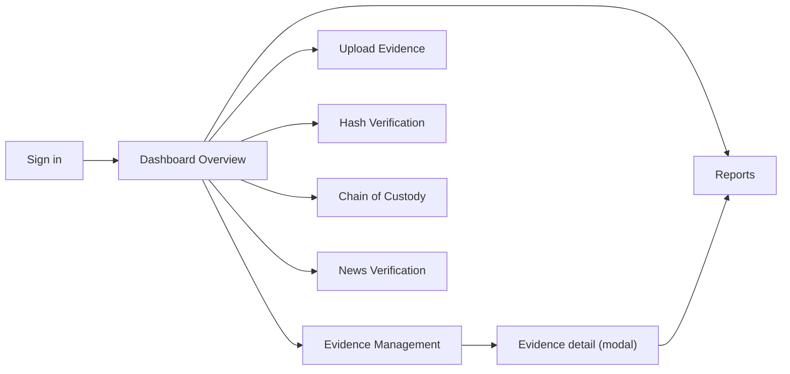

# Design

## 1. Design Goals
* **Clarity over decoration:** An examiner should see status, score, and reasons at a glance.
* **Calibrated language:** Wording never claims certainty. "Likely authentic", "Needs review", and "Suspicious" are used instead of "Real" or "Fake".
* **Evidence-first layout:** The most recent evidence is always visible with its gauges, heatmap, and custody trail.
* **Works everywhere:** Compatible across phone, tablet, and desktop viewports in both light and dark themes.
* **Quiet visual style:** Calm colours are applied uniformly, reserving distinct colour treatments strictly for meaning (such as risk levels and processing status).

> *Note: The information architecture was inspired by a reference demo of an evidence-integrity dashboard. The implementation is original.*

---

## 2. Information Architecture

### Page Breakdown

| Page | Purpose | Key Components |
| :--- | :--- | :--- |
| **Sign in** | Gate the demo app | Email, password input, and a clear notice specifying it is a simulated frontend login rather than true authentication. |
| **Dashboard Overview** | Comprehensive platform status | Stat cards, file upload zone, workflow pipeline, registry ledger, tamper detection indicators, authenticity engine, custody tracker card, custom analytics, metadata forensics, report center, and local system health metrics. |
| **Evidence Management** | Query and locate records | Search engine, state/status filter, "Refresh" utility, "Clear all data" option, and the primary registry table. |
| **Upload Evidence** | File intake utility | Drag-and-drop landing zone, pipeline state tracking with active progress feedback, latest execution results, and dedicated analysis panels. |
| **Hash Verification** | File consistency verification | Target record selector, file picker node, and match/mismatch result modules rendering both comparison hashes. |
| **Chain of Custody** | Audit trail ledger | Evidence selector dropdown, vertical event timeline, and chain integrity validation runner. |
| **Reports** | Data output center | Evidence selector dropdown, print-optimized document view, and raw JSON visualization block. |
| **News Verification** | Linguistic pattern checker | Claim string input textbox, scanning tier status tracker, algorithmic verdict text, red flag indicators, and "Not connected" dummy source cards. |

* **Persistent Chrome:** Left-docked navigation bar (collapses down into a horizontal strip on viewports under 760 px), quick-search bar targeting evidence IDs, manual master Refresh action, notification bell containing an active alert count badge, dark/light theme switch, and user sign-out action.

---

## 3. Key User Flows

* **Intake:** Navigate to **Upload Evidence** ➔ Drop or select a target file ➔ Watch the real-time five-step pipeline execute ➔ Review the analytical panels ➔ Open the generated report.
* **Verification:** Access **Hash Verification** ➔ Choose the record target (or allow auto-matching to run) ➔ Select the corresponding local file ➔ Read the match result verification text. *(This lookup execution is appended directly into the active custody trail).*
* **Audit:** Navigate to **Chain of Custody** ➔ Choose the record target ➔ Click the **"Verify chain integrity"** action button.

---

## 4. Components

* **Stat card:** Renders a clean descriptive label, an outlined status chip, a large numeric headline metric, and a short text caption.
* **Gauge:** A circular vector SVG ring embedding a centered percentage string. The active path color dynamically updates to reflect the matching risk tier.
* **Progress bar:** A linear track interface pattern utilized for tracking metadata trust metrics, hash integrity states, model confidence values, and processing pipeline progress.
* **Heatmap:** An 8x8 analytical grid display where cell background color intensity scales proportionally to the evaluated ELA error value. Appends a caption explicitly stating it serves as a heuristic indicator only.
* **Timeline:** A vertical axis track plotting a sequential block for each registered custody event log.
* **Registry table:** Rows are fully interactive and feature a distinct view icon. Implements a wrapper to scroll horizontally on restricted small screens.
* **Status pill:** Clean outlined pills mapping to discrete system state combinations: `verified`, `flagged`, `tampered`, `Low`, `Medium`, and `High`.
* **Charts:** Built using standard native markup patterns including CSS conic-gradients (Pie charts) alongside custom styled inline SVGs (Bar, Line, and Radar charts). Deployed completely free of third-party charting libraries.
* **Report:** Clean print-friendly markup. Left sidebar navigation links and active interactive controls are structurally hidden out of frame via CSS media rules when a print command triggers.

---

## 5. Visual System

### Colour Tokens

| Token | Light Theme | Dark Theme | Semantics & Meaning |
| :--- | :--- | :--- | :--- |
| `--bg` | `#f3f5fa` | `#0a1120` | Primary page canvas background |
| `--cd` | `#ffffff` | `#111b30` | Container card backgrounds |
| `--tx` | `#0f172a` | `#e6ecf8` | Primary interface reading typography |
| `--mu` | `#5b6b85` | `#93a2bd` | Secondary muted metadata typography |
| `--bd` | `#dbe2ee` | `#223250` | Structural borders and track backgrounds |
| `--ac` | `#2456d6` | `#5b8dff` | Main brand accent and interactive actions |
| `--ok` | `#15803d` | `#34d399` | Low risk status, verified logs, success conditions |
| `--wa` | `#b45309` | `#fbbf24` | Medium risk tier, flagged entries, tasks in-flight |
| `--er` | `#c42626` | `#f87171` | High risk tier, tampered files, destructive alerts |

*The active interface theme respects the host system configuration settings by default and supports manual overriding via the persistent toggle action.*

### Typography
* **Interface Reading:** Standard system sans-serif font stack.
* **Headings, Logo, & Big Metrics:** Georgia (serif) font stack. This treatment introduces a document-like typographic layout to the generated reports.
* **Hashes & Identifiers:** Fixed-width monospace font stack. 
* *Zero external web fonts are requested or loaded by the browser.*

### Shape and Spacing
Cards feature a standard `12px` border-radius layout, control elements use an `8px` boundary curve, and indicator status pills remain completely rounded. Grid layout spacing maps to structured increments of `8px`, `12px`, and `14px`. High-character SHA strings are explicitly configured to wrap naturally instead of breaking container overflows or truncating inside detail modal views.

---

## 6. Responsive Behaviour

| Viewport Width | Interface Structural Layout Behaviour |
| :--- | :--- |
| **Above 760 px** | Fixed left navigation panel layout (`215px`) paired alongside a multi-column content grid alignment. |
| **760 px and below** | Left navigation panel collapses down into a horizontal, swipe-scrollable top strip layout. Content cards cascade into stacked single columns, and header action controls wrap evenly. |
| **Any Size** | Active data tables independently scroll horizontally inside isolated container elements. The global page framework body never triggers a horizontal browser window scroll. |

* *Maintains strict compatibility layout buffers to cleanly isolate hardware display notches and safe-area screen insets.*

---

## 7. States and Feedback

* **Empty Registry:** Renders clear, plain-language text prompts instructing the user to perform their first file upload.
* **Processing States:** The structural pipeline items highlight sequentially in strict logical order, synchronized alongside a matching master progress bar.
* **Success UI:** Triggers a green success status pill accompanied by unambiguous verification text strings.
* **Warning UI:** Triggers an amber warning status pill accompanied by an inline list enumerating all computed file anomalies and heuristics.
* **Error UI:** Injects high-visibility red error typography explaining the exact processing failure reason (e.g., corrupted file binaries).
* **Destructive Actions:** Form buttons protect against accidental activation by forcing a safety double-tap pattern, requiring a secondary confirmatory click directly on the active node (`"Click again to confirm"`).

---

## 8. Content Guidelines
* Explicitly disclose exactly what elements have been analyzed alongside what layers skipped evaluation.
* Always bind a human-readable finding explanation panel immediately alongside numerical confidence metrics or scoring drop values.
* Avoid definitive words like `"proof"`, `"authentic"`, or `"fake"` when generating algorithmic verdicts.
* Explicitly tag all heuristic data outputs as tentative indicators rather than absolute statements of fact.

---

## 9. Accessibility

### Done
* Highly visible focus outlines are preserved across all native interactive components.
* Meaning is communicated through text descriptions rather than relying solely on color-coded states.
* Icon-only action elements feature descriptive accessible names.
* Fully responsive layout handling.
* Out-of-the-box support mapping directly to standard system dark mode configurations.

### Known Gaps (To Address)
* Registry data rows respond to mouse pointer clicks and touch actions only; keyboard execution patterns are currently missing.
* The expanded detail dialog lack active focus traps and does not handle close operations via the `Escape` key.
* Analytical gauges and graphical charts rely entirely on adjacent textual print statements and do not include distinct screen reader text alternatives.
